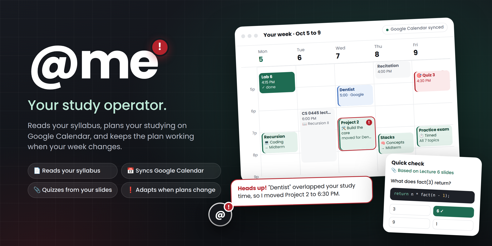
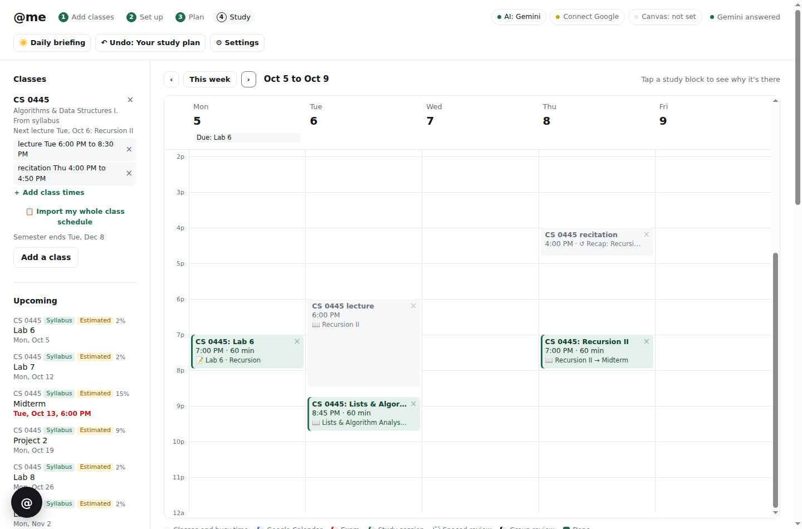
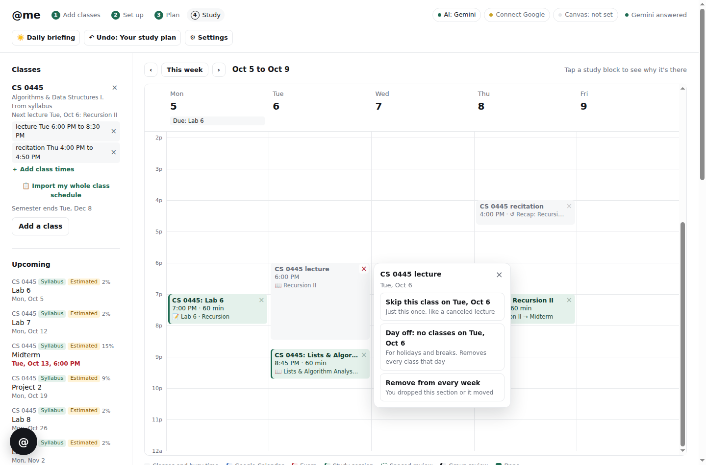
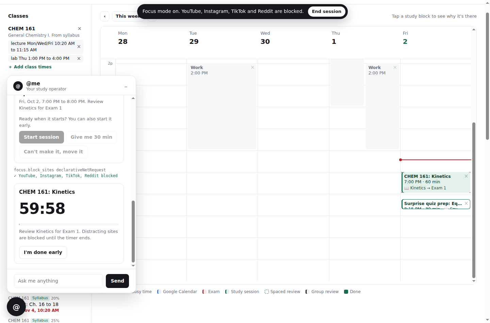
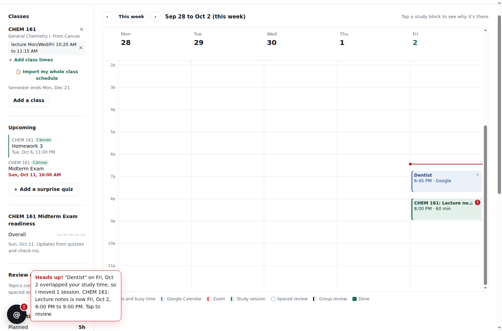

# @me

**Your study operator.** @me is a Chrome extension that reads your syllabi and Canvas courses, builds a study plan around your real schedule, keeps it in sync with Google Calendar, and helps you actually follow through.

Built at HackRU '26. Website: **[atme.tech](https://atme.tech)**



## What it does

- **Starts from nothing.** Import a syllabus (PDF, Word, or pasted text) or connect Canvas. @me finds class times, grade weights, every exam, quiz, lab, and project, and the topic of every lecture. Canvas imports only include this semester's courses.
- **Understands your syllabus.** It asks which lecture and recitation sections are yours, frees up holidays like Thanksgiving, and works out what each exam covers from the lectures before it. Got last year's syllabus? It can move everything to this semester on the same weekdays and mark those dates "Estimated."
- **Works even without AI.** Pasted text and Word files go through a built-in reader when no Gemini key is set, so @me works anywhere.
- **Gets your class times in fast.** Paste or screenshot your class schedule and @me adds every class at once, or use the class-times form or chat.
- **Plans around your life.** Study sessions fit around classes, work, and your Google Calendar events. Weekdays by default, weekends if you want them, and spread out early or kept closer to deadlines, your choice. Bigger exams get more time.
- **Starts projects early.** Projects get milestone sessions from the day they're assigned: plan, build, test, and submit, instead of a last-minute push.
- **Tells you what to do.** Every session has a type, like coding practice, concept review, or practice exam, with instructions for that kind of work.
- **Catches missed sessions.** If a session passes without you starting it, @me asks whether you did it and reschedules it if not.
- **Works both ways with Google Calendar.** Study sessions go on "@me Study," class times on "@me Classes" as weekly repeating events, and every exam, quiz, and assignment on "@me Deadlines" with reminders. @me shows your own events by name, checks for new ones every few minutes, and moves study sessions that clash.
- **Shows what you're studying.** Every block says what it covers: the lecture topic, a recitation recap, the lectures a session reviews and which exam it's for, or the lecture a lab builds on.
- **Easy to adjust.** Hit the × on any block to skip a class, mark a day off, remove or move a session, or ignore a Google event.
- **Knows what doesn't matter.** Set each class to Normal, Light, or None study time, so a gen-ed outside your major doesn't eat your week. Skip a single session, mark one exam or assignment "no prep," or mark a lecture topic "not important," and @me gives that time to what does matter.
- **Protects your sleep.** Nothing runs past your cutoff, and nights before exams end an hour early.
- **Keeps you focused.** Focus mode blocks YouTube, Instagram, TikTok, and Reddit during sessions.
- **Checks what you actually know.** Each session ends with a short quiz and a check-in. CS classes get code-tracing, Big-O, and spot-the-bug questions with real code, even offline.
- **Shows how you're really doing.** A proficiency panel above the calendar gives every lecture topic a bar, a level from Beginner to Mastered, and a trend, built only from scored questions. Hit **Check** on any topic for a 5-question self-check and watch the bar move.
- **A tutor built in.** After practice, **Grade my answer** has Gemini check your free-response answer against the model answer, and **Explain it** walks through any question you missed, using your own slides.
- **Exam practice on demand.** Say "review for my midterm" and @me writes a practice set: multiple choice plus free-response with model answers, from your notes and slides or just the topics. Your score updates your readiness and points you to what to review.
- **Quizzes like your class.** Add lecture slides (PowerPoint or PDF), notes, a study guide, or an old exam, and quizzes are written from them in your professor's terms and code style. Practice exams copy the old exam's style, and each answer says which slide it came from. Weak topics get extra sessions, and everything else comes back on a spaced-review schedule.
- **Handles surprises.** Add a surprise quiz, or let @me spot a new one on Canvas, and it squeezes in prep and raises a red exclamation on the toolbar.
- **Explains itself, and lets you take it back.** Tap any session to see why it's at that time. Undo any change, and Google Calendar follows.
- **Talks like a friend.** Say "my exam got moved to Thursday" or "I work Tue and Thu 2-6pm" and it updates your plan. Type **/help** to see everything it can do, or **/** for shortcuts like `/plan` and `/practice midterm`.

| The × menu | Focus mode | New Google event moves a session |
|---|---|---|
|  |  |  |

## Install it

1. Download @me from **[atme.tech](https://atme.tech/#install)** (or the [latest release](../../releases/latest)) and unzip it.
2. Open `chrome://extensions` in Google Chrome and turn on **Developer mode**.
3. Click **Load unpacked** and choose the unzipped `atme-extension` folder.
4. Pin @me from Chrome's puzzle-piece menu, click it, and choose **Open @me**.

It works right away with pasted or Word syllabi, and built-in quizzes. For PDFs and smarter quizzes, add a free Gemini key in Settings. To connect Google Calendar, click **Connect Google**. While @me is in Google's testing mode, your Google account needs to be on the tester list, so ask the developer to add you.

Full details, including Canvas and the developer's one-time Google setup, are in [docs/SETUP.md](docs/SETUP.md).

## Repo layout

```
extension/   The Chrome extension (Manifest V3)
site/        The atme.tech website: landing page and privacy policy
docs/        Setup guide, architecture notes, presentation script, screenshots
```

## Built with

- Chrome Extensions (Manifest V3): service worker, `declarativeNetRequest`, `chrome.identity`, alarms, notifications
- Gemini API, with structured output, for reading syllabi, schedules, slides, and handwritten notes, writing quizzes, grading free response, and chat
- Google Calendar API: your events (read-only) plus two calendars @me creates
- Canvas LMS REST API
- Plain JavaScript modules, no build step and no dependencies

## Privacy

Everything @me knows is stored locally in Chrome, and Google Calendar event details are never sent to an AI service. Full details are in the [privacy policy](site/privacy.html). Your AI key and Canvas token never leave your computer except to talk to those services. Google access is read-only for your own events, and @me can only edit the calendars it creates.

## License

MIT. See [LICENSE](LICENSE).
